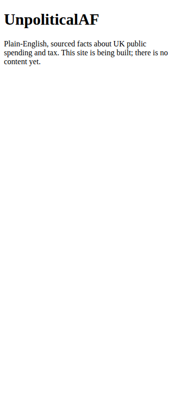
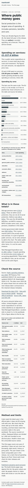

# Browser evidence

## Baseline

- Revision: `f5886d8514eaaa5c46b55646cef35243a7ece04e`.
- The original `site/index.html` was exported from that revision before any site changes and served by the test harness over local HTTP. These are real Chromium screenshots of the original placeholder, not a recreated design.
- [Mobile baseline (360 × 800)](before-index-html-mobile.png)
- [Desktop baseline (1280 × 900)](before-index-html-desktop.png)
- [Baseline metadata](before-browser-report.json) records capture time, revision, browser version and exact HTML hash. Baseline mode captures only; it does not claim the placeholder passed the product checks.
- GitHub API investigation on 2026-11-01: `gh api repos/jnyross/UnpoliticalDeepSeekSuperAgent/deployments` returned `[]`; the baseline commit status endpoint also returned no statuses or deployment links. No deployed URL was available to verify at baseline.

## Post-build result

- [Mobile after (360 × 800 viewport; full page)](after-index-html-mobile.png)
- [Desktop after (1280 × 900 viewport; full page)](after-index-html-desktop.png)
- [Automated results and exact tested HTML hash](after-browser-report.json)
- Final generated HTML: 11,393 bytes (under 500 KB), SHA-256 `72db0de6730d574dc07bdfd9eb715aed79cb3729883d29e7fa37aff3b0db3295`. This hash identifies the final tested content before the parent commits it; `baseRevision` is not the implementation revision.
- Captures include the final mobile source-table fix: numeric values remain on one line at 360 px.
- At both widths, JavaScript-disabled core text and visible text match the normal rendering; document and body width equal the viewport, without overflow in either JavaScript mode.
- Axe WCAG A/AA checks pass at both widths: zero violations, zero incomplete results. The page currently has no collapsed expandable states.
- Images were inspected by the coding agent for layout only. This is not people testing, a manual keyboard check, or a screen-reader check.

## Reproduction

```sh
npm ci
npx playwright install --with-deps chromium
npm run test:browser
```

The test starts and stops its own loopback static server. It discovers every generated HTML page, checks each at 360 × 800 and 1280 × 900, compares core text with JavaScript disabled, checks the 500 KB limit and horizontal overflow, and runs axe with WCAG 2.0/2.1/2.2 A/AA tags (including contrast). Native details and available expandable buttons are also checked after expansion. Results report any axe checks requiring further review; automated results are not manual keyboard, screen-reader or people evidence.

Local host note: this machine runs Ubuntu 26.04, unsupported by this Playwright version. Browser installation and execution used `PLAYWRIGHT_HOST_PLATFORM_OVERRIDE=ubuntu24.04-x64`; CI uses supported Ubuntu 24.04 directly.

CI stores new images and reports as its `browser-evidence` artifact. Committed evidence is retained separately in this directory. The post-build report records the base Git revision and exact hashes of generated working-tree HTML; if capture occurs before the implementation commit, those hashes identify the tested content rather than implying that the base revision contains it.

## Embedding images in a pull request

Images in this directory are intended to be committed with the implementation. Embed their raw links in the PR, replacing `HEAD_SHA` with the commit containing them, for example:

```markdown


```

Private repository raw images require an authenticated viewer. Also provide normal repository file links as a fallback; do not publish an access token in an image URL.
