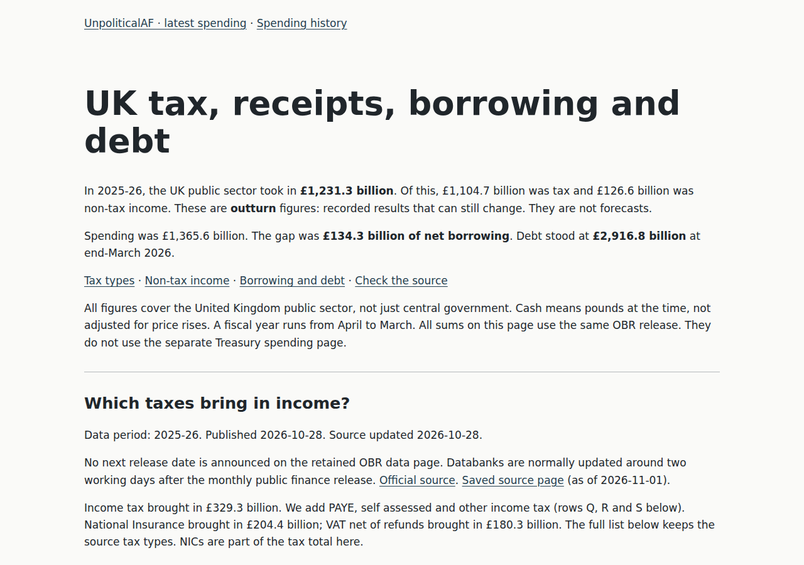
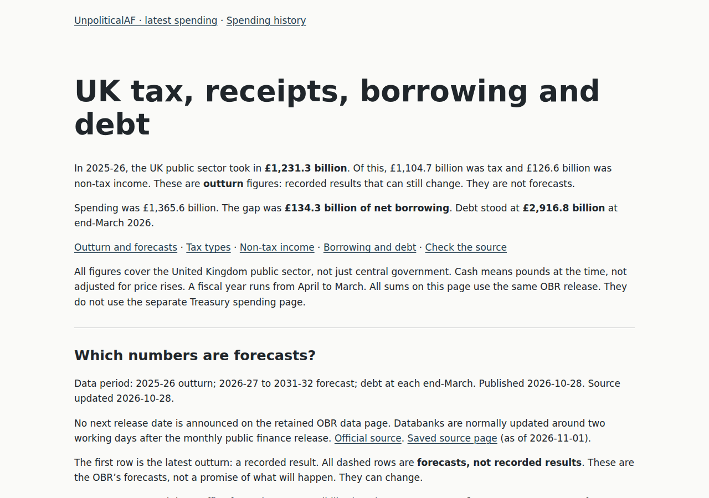
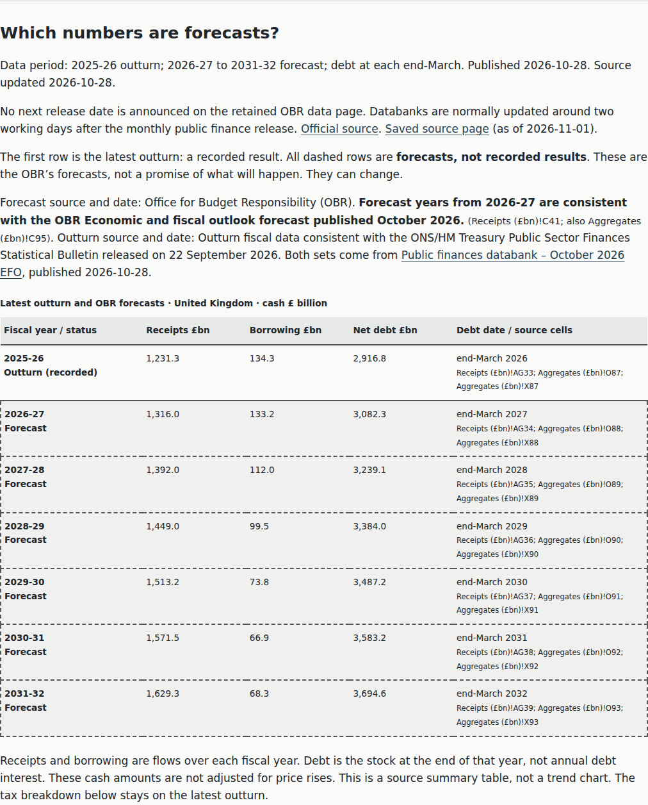
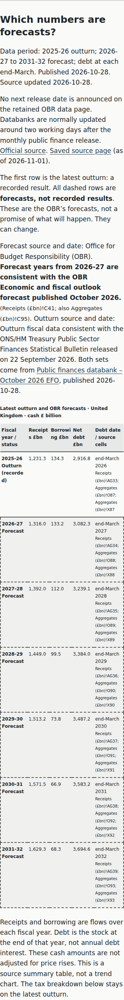

# Context L2 — forecast comparison

Actual Chromium application captures, not mockups. Both revisions use the same
income page, light/default theme, initial state (no expanded controls), and
360×800 / 1280×900 viewports. Full-page captures include the new forecast section;
viewport captures show its position relative to the existing introduction.

- **Before:** `a2a09439bf25027b1f81ef797f4f4324df95e88b`, retained baseline application.
  The production income HTML was also fetched and byte-compared with this baseline.
- **After:** `8f34c1258d4743ca5eaee3458052e87f41e4123a` application HTML. Subsequent
  evidence-only changes do not change the rendered page. The browser
  report records the exact tested HTML SHA-256.

## Before

[Desktop full page](before-income-html-desktop.png) · [Mobile full page](before-income-html-mobile.png)

## After

[Desktop full page](income.html/desktop/after-income-html-desktop.png) · [Mobile full page](income.html/mobile/after-income-html-mobile.png)

## Forecast detail

These additional After-only close-ups make the text labels, solid outturn border
and dashed forecast borders legible. The full-page Before/After pair above is the
comparison evidence; these close-ups are not a substitute for that pair.

Browser reports are automated checks, not manual keyboard, screen-reader or
user-test evidence. Source labels distinguish the October 2026 EFO forecast from
the September 2026 outturn bulletin and the 28 October databank publication.
