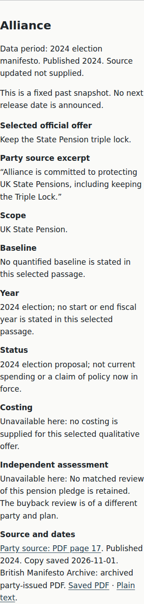
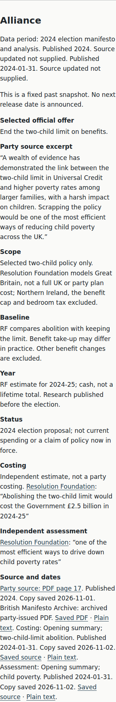
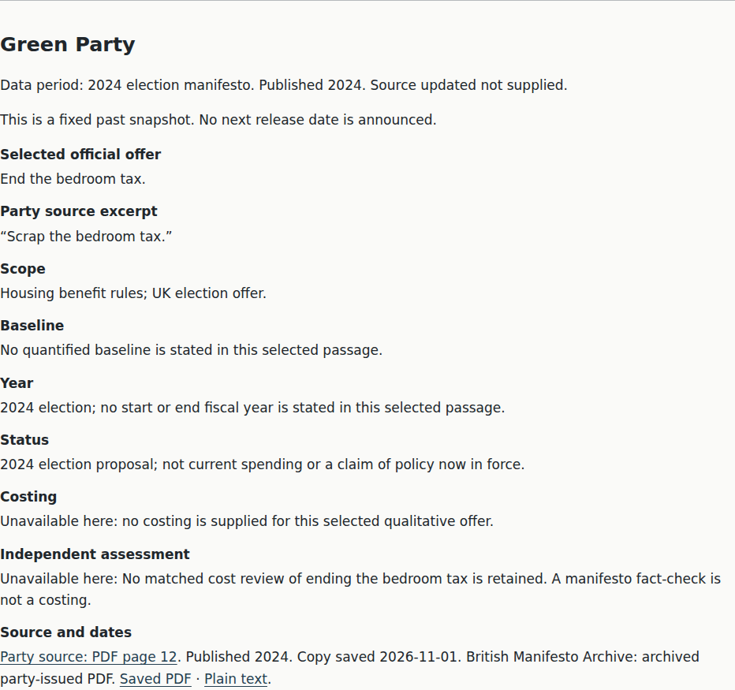
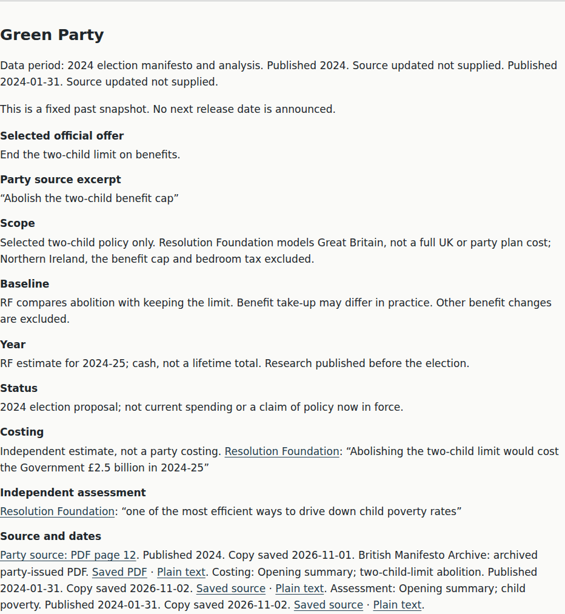

# Coverage wave 5 — real application comparison

No Coverage L4 claim. Issue 32 remains open: the examples are selected policies, not full costed-plan reviews.

## Revisions and scenario

- **Before:** `9b3f2b2d775850cd09b20d361a807a095527ff83` (merged main before this wave).
- **After:** `dddfd4ee47e277b807a844f3f72a52041a8ea942` (implemented data, validation and generated page).
- Same real static application, Chromium, light theme, JavaScript disabled, initial state, mobile **360×800** and desktop **1280×900**.
- Captures use the actual generated HTML, not mockups. All baseline party cards were saved before editing source data; the seven changed cards were captured after rebuilding. Full-page and viewport screenshots and machine reports are also retained.
- [Revision map](revision-map.json) verifies each browser report's HTML hash against the actual page in its named git revision. Reports were captured from the working tree before its implementation commit, so their `baseRevision` alone is not the tested content identity; `pages[].sha256` is.

| Scenario | Before | After |
|---|---|---|
| Alliance, mobile, same card |  |  |
| Green, desktop, same card |  |  |

The source data and template change naturally alter card heights; viewport, theme and state remain identical. The resulting source dates, policy exclusions, independent-estimate label and remaining assessment gap are visible, not cropped out.

## Validation

```sh
.venv/bin/python scripts/build.py
.venv/bin/python scripts/build.py --check
# All nine pages pass provenance, values, reconciliation, banned-word, size and reading-grade gates.
# Deterministic generated-file comparison: none changed.
.venv/bin/python -m unittest discover -s tests -p 'test_*.py'
# 196 tests passed after refreshing the changed HTML hash in the manual-task inventory.
CHECK_PAGE=parties.html EVIDENCE_LABEL=after EVIDENCE_DIR=docs/evidence/coverage-w5 npm run test:browser
# Both viewport tasks passed: no-JS, overflow/size, zero axe violations, supplemental contrast checks.
node docs/evidence/coverage-w5/capture-cards.mjs
# Real changed-card captures at both widths.
```

Party page reading grades: **5.6660** complete text, **6.1199** words-only, **6.1265** prose words-only; all below 7. Manual accessibility inventory changes only the party page's hash: no human keyboard/screen-reader evidence was created. Before capture-only reports document visual identity, not a new claim to have rerun baseline automated checks.

## Evidence decisions and remaining gaps

Resolution Foundation's pre-election January 2024 analysis supplies an exact selected-policy estimate and attributed judgement for Alliance, Green, Plaid Cymru and SNP commitments to remove the two-child limit. The estimate is **Great Britain, 2024-25**, not a party costing or full UK total. Northern Ireland, other welfare measures and complete manifesto costs are excluded; benefit take-up uncertainty is stated beside the estimate.

Three additional party-provided cash claims (Reform departmental savings, SDLP windfall tax and UUP Skills Fund) are checked against the actual cited PDF pages. Their independent assessment fields remain unavailable: related fact-checks are not transferred to unlike policies. Existing Conservative, Labour and Liberal Democrat examples remain unchanged.

There are now seven selected examples with independent quotations, three cost-only examples and three examples without a checked cost. This is not complete coverage of every party's costed plans. The research notes retain the unselected Alliance buyback, Plaid CGT and SNP NHS leads, related-but-unmatched reviews, access failures and precise gaps rather than inventing assessments.
