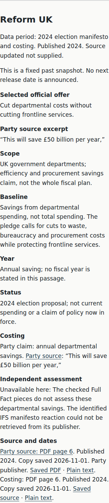
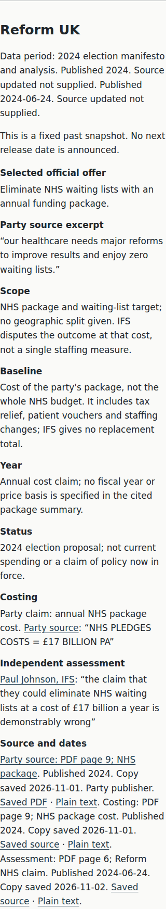
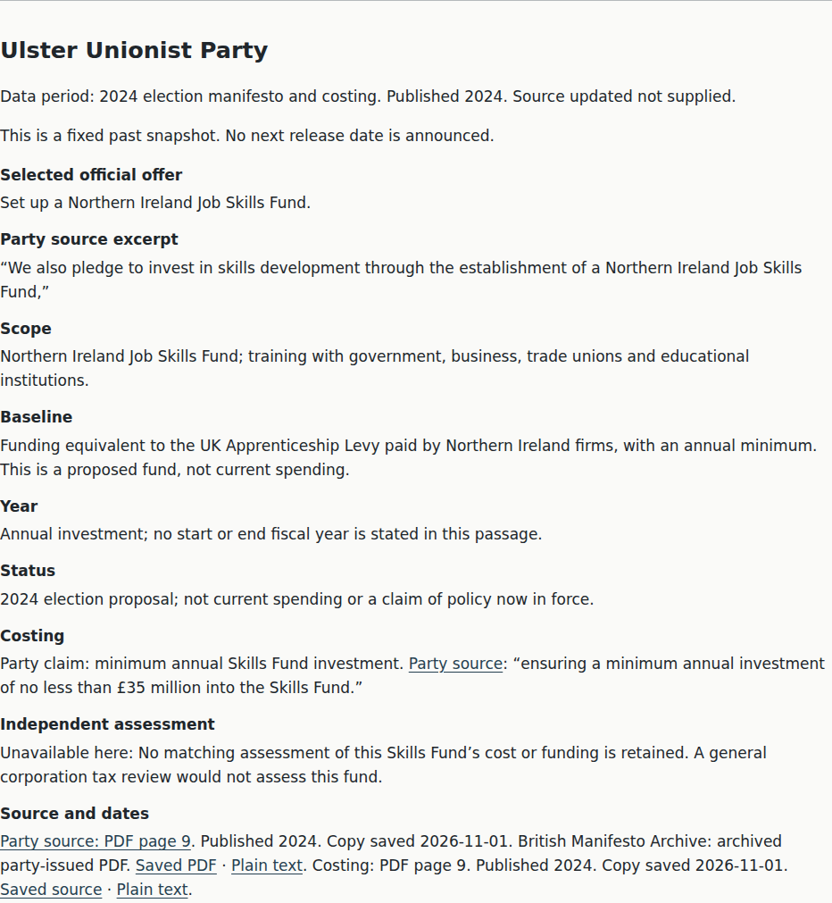
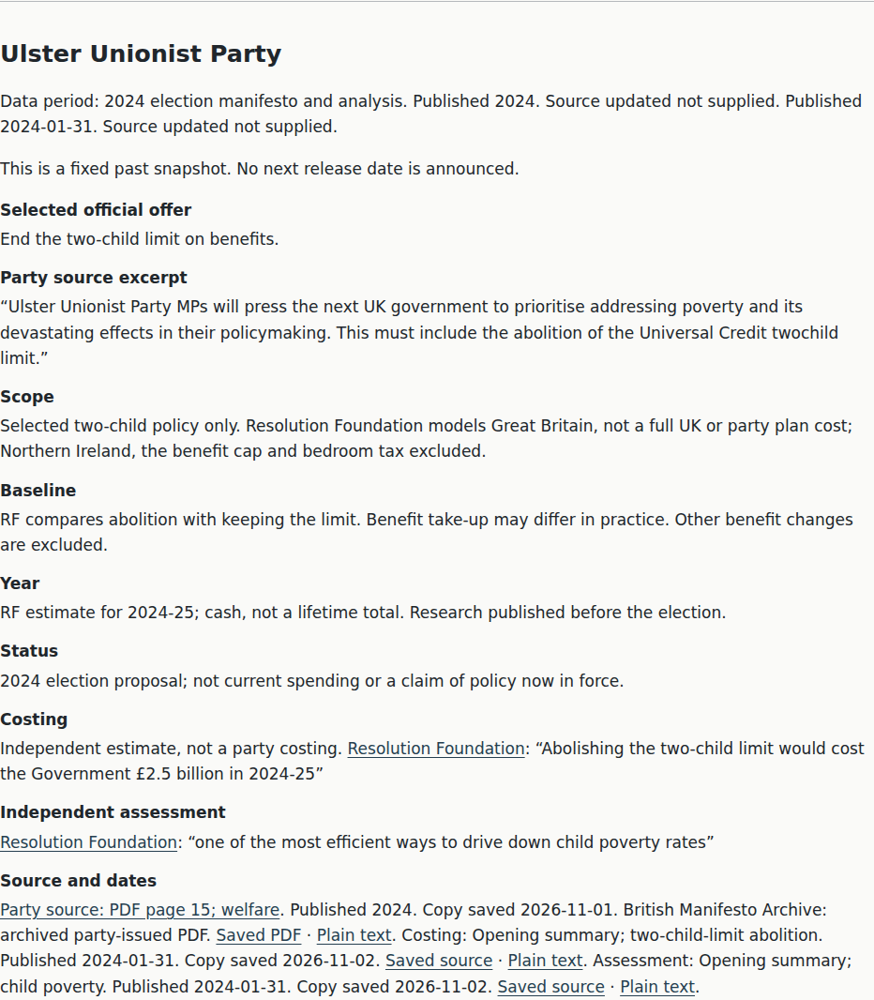
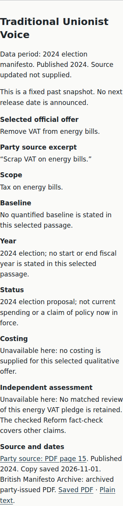
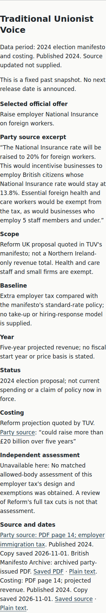

# Coverage wave 6 — matched evidence, not an L4 award

## Actual Before / After

- **Before:** `693386bc035b0a3489718bee9712922748c181b7`, party HTML SHA-256 `9f1ee00fe01e45e10699330451806d1e1211c8744ed0bdc55c3a7f2739258e8c`.
- **After:** `50d3012355134307f235ba80401ce571b3cca5b7`, party HTML SHA-256 `1d22501b759f45259eb4b5b7e6d7282d2014cf9985488563952788a437bea395`.
- Same real static application, Chromium, light theme, JavaScript disabled, initial party-card state. Mobile **360×800** and desktop **1280×900**.
- [Revision map](revision-map.json) verifies each report's tested HTML hash against its named immutable git revision. Browser reports were captured before the working tree's implementation commit; their `baseRevision` is not the tested-content identity. `pages[].sha256` is.

| Same party/card state | Before | After |
|---|---|---|
| Reform, mobile |  |  |
| UUP, desktop |  |  |
| TUV, mobile |  |  |

Full-page, viewport and changed-card captures at both widths are retained alongside the machine reports. These are actual application captures, not mockups. Card heights change naturally with the text; no qualification is cropped out. Baseline capture-only runs establish image/content identity, not a claim of newly rerunning baseline accessibility tests.

## Source decisions

- **Reform:** switch the selected proposal from departmental savings to its entire NHS waiting-list package. Official manifesto PDF page 9 gives the party's £17bn annual claim. Paul Johnson's obtainable official IFS opening-remarks PDF (24 June 2024), page 6, directly disputes eliminating NHS waiting lists at that cost. It is not the unrelated Full Fact NHS roundup. No replacement IFS cost, geographic split, fiscal year or price basis is invented.
- **UUP:** the actual manifesto PDF page 15 calls for UK-government abolition of the Universal Credit `twochild` limit. Its spelling explains why earlier narrower searches missed the commitment. Apply the same RF selected-policy estimate as the other unrestricted-repeal examples: Great Britain, 2024-25, independent estimate rather than party costing, no NI add-on or whole-plan endorsement, with take-up uncertainty stated.
- **TUV:** its own manifesto page 14 reproduces and endorses the Reform employer-immigration-tax design and a projection of **more than £20bn over five years**. Keep exemptions visible and label the amount as a Reform projection quoted by TUV, not independently verified revenue. A criticism of Reform's overall tax package is not transferred to this specific TUV measure.

There are now **nine selected examples with independent quotations, two cost-only examples and two without a checked cost**. DUP, Sinn Féin, SDLP and TUV still lack a matched independent assessment here. DUP and Sinn Féin still lack a checked forward cost for their selected offer. Issue 32 remains open; no Coverage L4 claim.

## Checks actually run

```sh
.venv/bin/python scripts/build.py
.venv/bin/python scripts/manual_access.py --write
.venv/bin/python scripts/build.py --check
# All nine pages pass provenance/raw values/reconciliation/source/size/banned-word/grade gates.
# No changed generated output after rebuild. Manual inventory changes only party HTML hash.
.venv/bin/python -m unittest discover -s tests -p 'test_*.py'
# 206 tests PASS.
CHECK_PAGE=parties.html EVIDENCE_LABEL=after EVIDENCE_DIR=docs/evidence/coverage-w6 npm run test:browser
# Both mobile/desktop tasks PASS: no-JS, layout/overflow/size, zero axe violations and contrast checks.
node docs/evidence/coverage-w6/capture-cards.mjs
```

Party grades: **5.7672** complete text, **6.2456** words-only, **6.2742** prose words-only. Added regression coverage rejects wrong independent PDF page, wrong publisher attribution, incompatible source/locator formats and a forged, hash-consistent transcript that is absent from the actual cited PDF page. Existing HTML/PDF provenance, amounts, equal template and scoped date/revision tests remain in force. No manual keyboard/screen-reader result or other people evidence was created.
