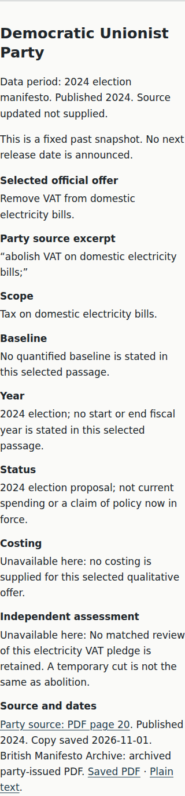
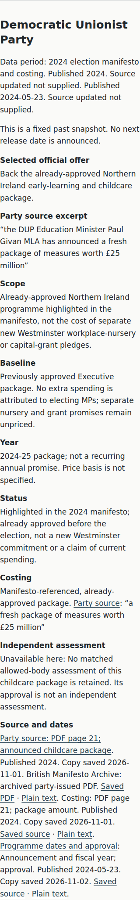
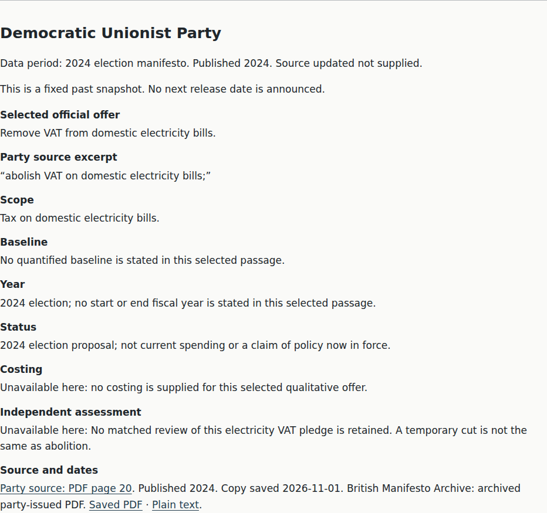
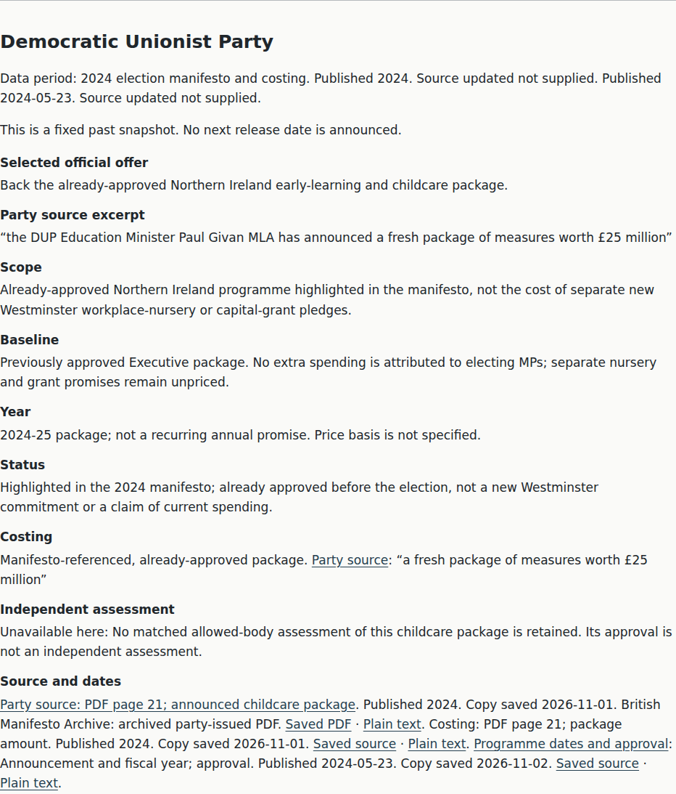

# Coverage wave 7 — approved programme context, not a new assessment

The useful new result is a verified DUP manifesto-highlighted **£25m, 2024-25** childcare programme. It is prominently identified as **already approved before the election**, not a cost for separate new Westminster nursery/grant promises. No additional independent assessment was obtained. DUP, Sinn Féin, SDLP and TUV assessment gaps remain; Sinn Féin's selected offer and the DUP's separate new commitments remain unpriced. **No Coverage L4 claim; issue 32 stays open.**

## Real Before / After

Before is the actual generated party page at main `138bb7c`. After is implementation `bf60165624035a71888444ec1d03f22c71629fc2`. [Revision map](revision-map.json) pins both full git revisions and tested HTML hashes. Same Chromium, light theme, JavaScript disabled, initial card state; **360×800 mobile** and **1280×900 desktop**. Each report's `pages[].sha256`, not its working-tree `baseRevision`, establishes tested-content identity.

| Same state | Before | After |
|---|---|---|
| DUP mobile |  |  |
| DUP desktop |  |  |

Full-page and viewport images also capture the short shared-method clarification: some manifesto claims refer to already-approved programmes; they are labelled, not treated as new money. No design format, party order, colour or scoring changed. All cards retain identical fields and word limits. Baseline capture-only establishes actual images/content identity, not a new baseline accessibility test.

## Verified provenance and narrow interface

- Primary party PDF page21 directly quotes the announced £25m package, separately from the next paragraph's election commitments.
- [Official Department of Education source, 23 May 2024](../../research/coverage-w7/dup/README.md) confirms the 2024/25 period and Executive approval. It supports context, **not** an independent policy judgement or a recurring annual amount.
- Optional `evidence.programme` stores exact official funding/year and approval spans, with distinct text-line locators. It requires a checked party cost and explicit approved-programme status. Both spans are re-extracted from the raw government HTML and checked against the transcript; wrong lines, forged quotes and status/context removal fail closed.
- This role cannot replace party-owned cost evidence or masquerade as an independent assessment. Existing source-date/revision scoping works for the additional reference; a government-body revision notice appears only on the DUP card. The government URL is in exact-host retained-URL discovery, not claimed as new-publication or exact-calendar discovery.
- [Remaining NI research](../../research/coverage-w7/ni/selected-policy-research.md) and [TUV candidates](../../research/coverage-w7/tuv/README.md) document newly checked alternatives and specific access/design limits, not universal source absence. No snippets or Channel 4 judgements were presented as allowed-body evidence.

## Actual checks

```sh
.venv/bin/python scripts/build.py
.venv/bin/python scripts/manual_access.py --write
.venv/bin/python scripts/build.py --check
# PASS all nine pages: provenance/raw values/reconciliation, source names,
# byte limits, banned words and three reading-grade gates. Generated drift: none.
.venv/bin/python -m unittest discover -s tests -p 'test_*.py'
# 252 tests PASS, including new programme role/status/approval/year and revision-locality regressions.
CHECK_PAGE=parties.html EVIDENCE_LABEL=after EVIDENCE_DIR=docs/evidence/coverage-w7 npm run test:browser
# Both viewports PASS: actual no-JS content, layout/overflow/size,
# zero axe violations and supplemental contrast checks.
```

Party grades **5.7911 / 6.2792 / 6.3125** (complete / words-only / prose). Manual-material inventory updates only the party HTML hash; no manual checks or people evidence are claimed. The displayed-figure trace has **24 occurrences**, **17 without a matched publisher table**; no Accuracy L2 claim. Nine independently quoted examples remain nine. There are two other cost-only examples, one explicitly already-approved programme, and one selected offer without checked cost.
