# Issue 23 visual comparison

Actual Chromium captures of the generated application, not mockups. All pairs use
360 × 1000 CSS pixels, the light theme, JavaScript disabled, and the same state.

- Before: `7dcfa18bba3d912505ebb658ab5caf666ad0acf8` (unchanged generated HTML
  copied before edits).
- After: the changed revision containing this directory; the PR identifies its
  commit. Screenshots are regenerated from the same rendered HTML committed there.

| Scenario | Before | After |
| --- | --- | --- |
| Spending page at `#total` | 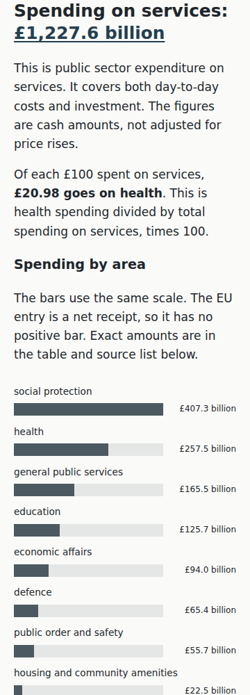 | 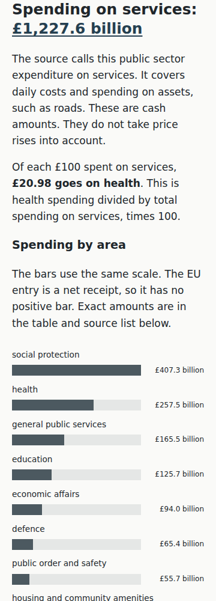 |
| Party page at top, no expanded state | 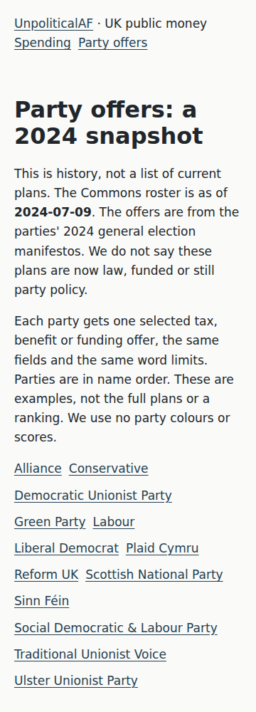 | 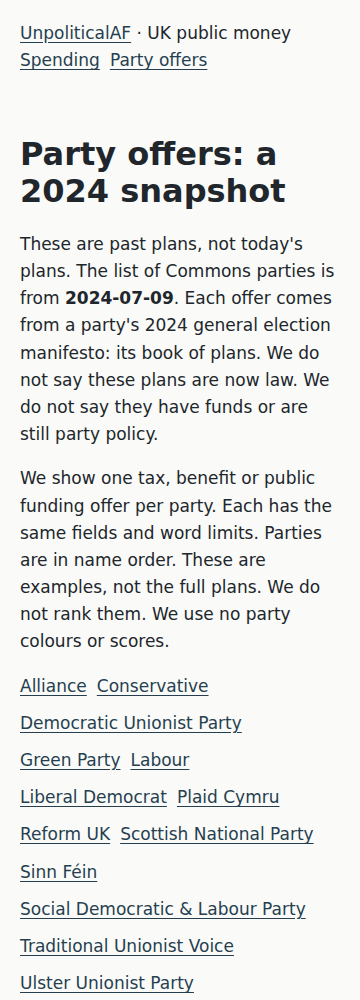 |
| History page at top, default details state | 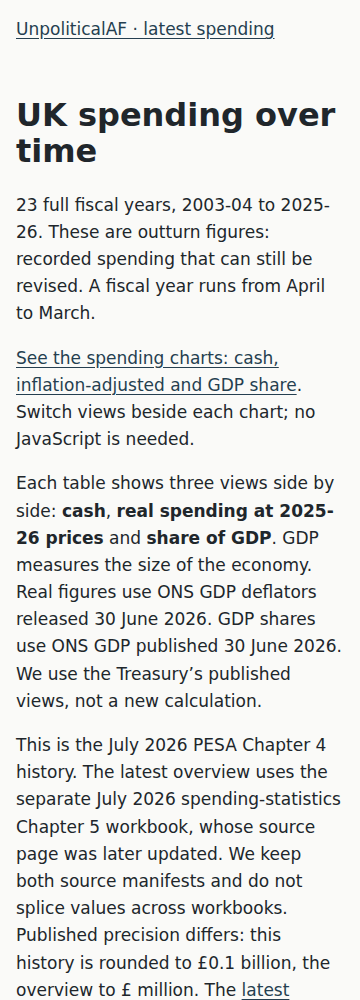 | 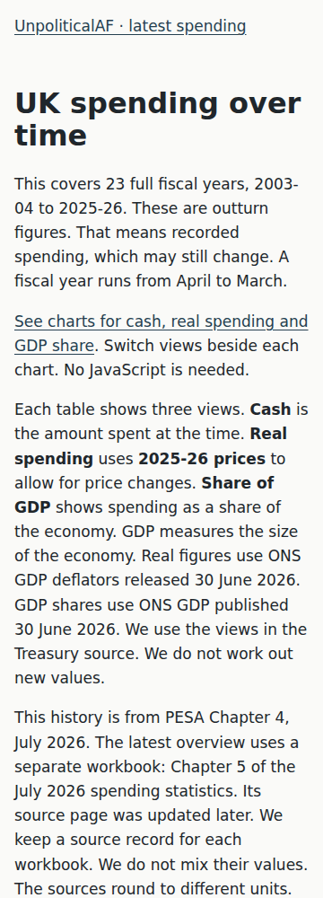 |
| Cash chart page at top, default details state | 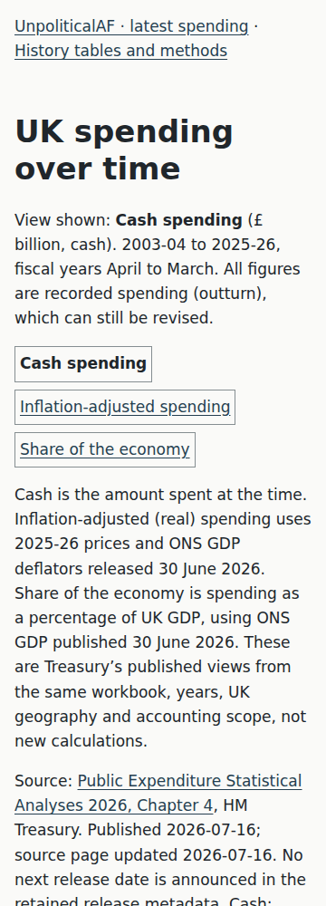 | 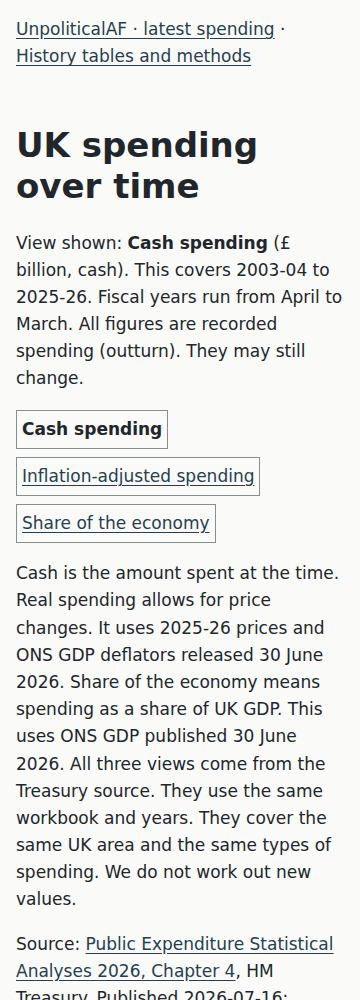 |
| Real chart page at top, default details state | 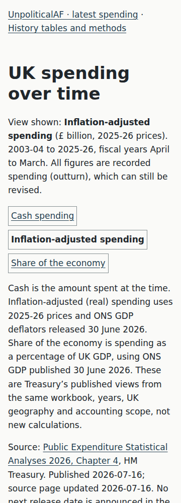 | 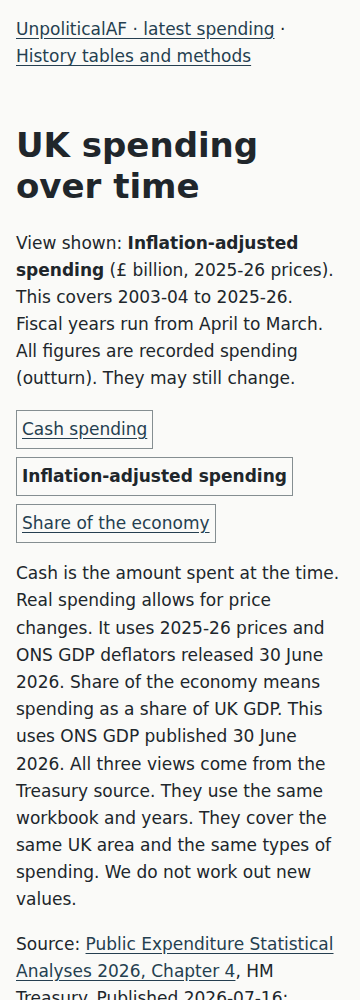 |
| GDP chart page at top, default details state | 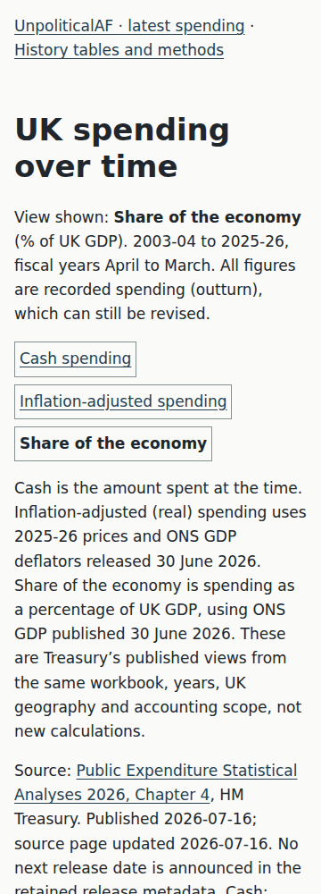 | 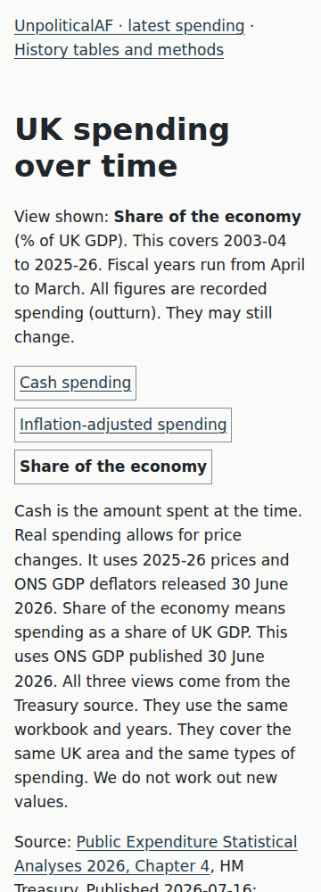 |
| Income page at `#non-tax` | 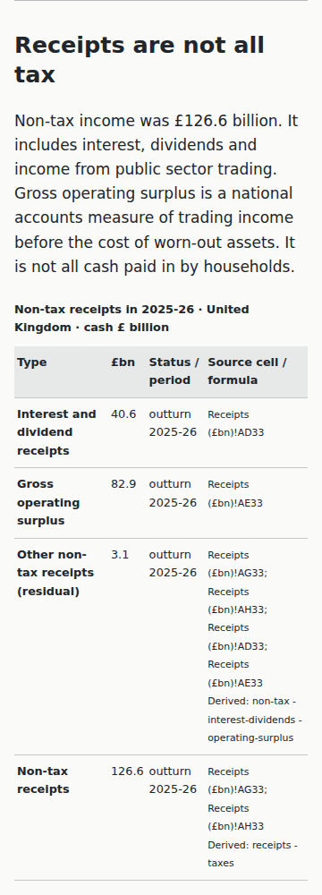 | 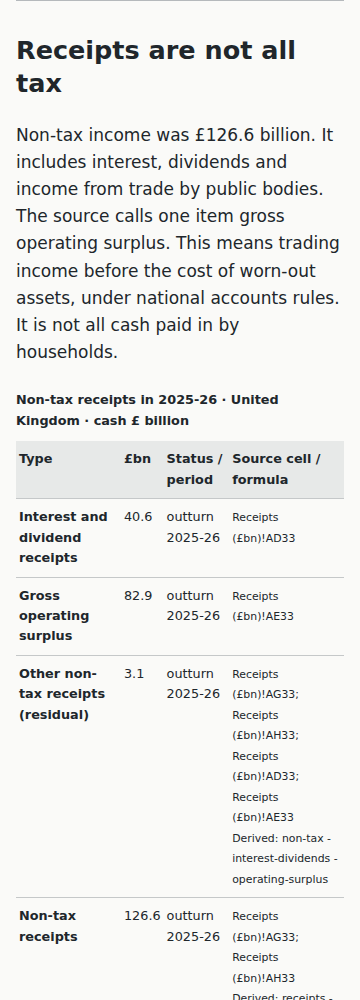 |

These are automated visual captures, not people-based comprehension or accessibility evidence.
